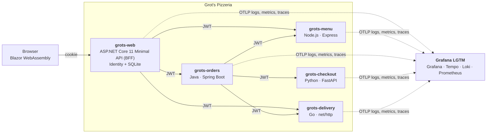

# aspnetcore-11-loves-open-telemetry

ASP.NET Core 11 💖 OpenTelemetry

_Grot's Pizzeria_ is a sample application demonstrating ASP.NET Core 11's improved support
for [OpenTelemetry](https://opentelemetry.io) and HTTP Server Semantic Conventions.

## Architecture



| Service | Language / framework | Role | Port |
| --- | --- | --- | --- |
| `grots-web` | C# · ASP.NET Core 11 Minimal API | Serves the Blazor UI and is its back-end-for-front-end: accounts and the `/api` surface | 8080 |
| `grots-menu` | Node.js · Express 5 | The pizza catalogue and price quotes | 8081 |
| `grots-orders` | Java 25 · Spring Boot | Order orchestration: price ➡️ pay ➡️ schedule delivery | 8082 |
| `grots-checkout` | Python · FastAPI | Payments | 8083 |
| `grots-delivery` | Go · `net/http` | Delivery tracking | 8084 |

- **UI**: Blazor WebAssembly (`src/GrotsPizzeria.Client`).
- **Authentication**: ASP.NET Core Identity (EF Core + SQLite) issues a cookie to the browser. A demo account is seeded:
  `grot` / `Grot!Pizza1`.
- **Service-to-service security**: the BFF mints short-lived HS256 JWTs and every service validates them (signature, expiry,
  issuer, audience). `grots-orders` forwards the caller's token downstream.
- **Telemetry**: each service uses OpenTelemetry SDKs with HTTP server and client instrumentation, configured through
  standard `OTEL_*` environment variables.

| Service | How it is instrumented |
| --- | --- |
| `grots-ui` (the Blazor client, in the browser) | The OpenTelemetry .NET SDK running in WebAssembly, exporting OTLP/HTTP straight to the collector: Blazor's built-in component spans and metrics, plus spans for UI actions and HTTP calls. The browser's trace continues on the server |
| `grots-web` | The OpenTelemetry .NET SDK + OTLP exporter, listening to the instrumentation **built in to ASP.NET Core and .NET**, plus `OpenTelemetry.Instrumentation.EntityFrameworkCore` for the SQLite database |
| `grots-menu` | `@opentelemetry/sdk-node` + `@opentelemetry/auto-instrumentations-node` |
| `grots-orders` | The OpenTelemetry Java agent (zero code) + `opentelemetry-api` for a custom metric |
| `grots-checkout` | `opentelemetry-distro` zero-code auto-instrumentation (`opentelemetry-instrument`) |
| `grots-delivery` | The OpenTelemetry Go SDK with `otelhttp`, `runtime` and `otelslog`, exporters chosen by `autoexport` |

The wire contract between the services (endpoints, payloads, environment variables, JWT claims and the custom `grot.*`
telemetry) is documented in the [service contract](docs/service-contract.md).

## Prerequisites

To run the whole sample you need:

- [Docker](https://www.docker.com/) with Compose v2 (Docker Desktop on Windows/macOS, or Docker Engine on Linux).
  Everything in the stack runs in containers, so no other language toolchain is needed.
- Around 4 GB of free memory for the containers and a few minutes for the first image build.

Additionally, depending on what you want to do:

| To... | You need |
| --- | --- |
| Run with Aspire, or run the tests | The [.NET 11 SDK](https://dotnet.microsoft.com/download/dotnet/11.0) and Docker |
| Use the [Aspire CLI](https://aspire.dev/get-started/install-cli/) (`aspire run`) | The Aspire CLI (optional: `dotnet run` and IDEs work too) |
| Run `build.ps1`, or the Playwright tests | [PowerShell 7+](https://learn.microsoft.com/powershell/scripting/install/installing-powershell) (`pwsh`) to install the browser |
| Run a service outside Docker | That service's toolchain: Node.js 26+ (menu), JDK 25 (orders; Maven is provided by the wrapper), Python 3.15+ (checkout), Go 1.27+ (delivery) |
| Work on the UI or BFF | The .NET 11 SDK; an IDE such as Visual Studio 2026 or VS Code with C# Dev Kit |

## Running the sample

### With Docker Compose

```sh
docker compose up --build
```

| What | Where |
| --- | --- |
| Grot's Pizzeria | <http://localhost:8080> |
| Grafana | <http://localhost:3000> (user `admin`, password `admin`) |
| OTLP (gRPC / HTTP) | `localhost:4317` / `localhost:4318` |

Sign in as `grot` / `Grot!Pizza1` (or register), add some pizzas, sides and desserts, and place an order.

Use a card ending in `0000` to see a declined payment. About 5% of payments fail with a simulated gateway
error (`CHECKOUT_FAILURE_RATE` on the checkout service), so you will occasionally see errors without asking for them.

Every 5 minutes a pizza, a side and a dessert, chosen at random, go on **special offer** at 15% off.
The menu highlights them, and the price you are charged is the offer price.
`SPECIAL_OFFERS=off` on the menu service switches the offers off.

#### Notes

- Telemetry is persisted in the `lgtm-data` volume and users in the `grots-web-data` volume, so both survive restarts.
  `docker compose down -v` removes them.
- The applications get all of their OpenTelemetry configuration from the `x-telemetry` block in
  [docker-compose.yml](docker-compose.yml). To send telemetry somewhere else, set
  `OTEL_EXPORTER_OTLP_ENDPOINT` (and `OTEL_EXPORTER_OTLP_HEADERS` in an override file) before `docker compose up`.
- The services share a JWT signing key. A demo default is built in to the compose file; set `JWT_SIGNING_KEY` to use your own.

### With Aspire

The [AppHost](src/GrotsPizzeria.AppHost) runs the same stack under [Aspire](https://aspire.dev). The BFF runs as a .NET
project (so you can debug it) and the Node.js, Java, Python and Go services are built from their Dockerfiles. A random JWT
signing key is generated for each run.

```sh
aspire run
```

or `dotnet run --project src/GrotsPizzeria.AppHost`, or open the solution in Visual Studio / VS Code and start the
`GrotsPizzeria.AppHost` project. The Aspire dashboard opens and lists every resource, with its logs, traces and metrics.

> [!WARNING]
> This is a sample, and the launch profiles run the Aspire dashboard **without authentication**
> (`ASPIRE_DASHBOARD_UNSECURED_ALLOW_ANONYMOUS`), so that the browser can send its telemetry to the dashboard's OTLP
> endpoint without an API key. Anyone who can reach the dashboard's ports can see the telemetry and send their own.
> Do not run it like this anywhere other than on your own machine. The default `https` profile uses the ASP.NET Core
> development certificate, so run `dotnet dev-certs https --trust` once if the browser's telemetry does not arrive.
> Aspire receives the telemetry itself, so this mode does not use the LGTM container.

While debugging like this every trace is recorded: the AppHost sets `OTEL_TRACES_SAMPLER=always_on` for all five
services, the web project's `http` launch profile sets it too, and the browser's SDK samples everything when the app runs in
the Development environment. (The default, `parentbased_always_on`, also records every root span, but it respects an
upstream caller's decision not to sample, which can leave gaps in the trace you are looking at.) The Compose stack uses the
SDKs' defaults. When you run a service on its own, set `OTEL_TRACES_SAMPLER=always_on` yourself.
`grots-web` honours `OTEL_TRACES_SAMPLER` and `OTEL_TRACES_SAMPLER_ARG` (`always_on`, `always_off`, `traceidratio` and the
`parentbased_*` samplers), but never records health checks, whichever is chosen.

### Running one service on its own

Each service has its own README with the exact commands - see the following documentation.

- [services/menu](services/menu)
- [services/orders](services/orders)
- [services/checkout](services/checkout)
- [services/delivery](services/delivery)

## Looking at the telemetry

Open Grafana at <http://localhost:3000>. The home dashboard is **Grot's Pizzeria: HTTP semantic conventions**
([source](deploy/grafana/dashboards/grots-http-semconv.json)). Use the **Application** drop-down to look at one service,
several, or **All**. It shows:

- **HTTP server** (`http.server.request.duration`): request rate, error rate, latency percentiles, status codes and the
  slowest routes.
- **HTTP client** (`http.client.request.duration`): outbound requests and latency by destination, and their status codes.
- **Logs**: the selected applications' logs from Loki, with a search box.
- **Traces**: recent server and client spans, and slow or failing requests, from Tempo. Open one to see a request cross all
  five services.
- **Database**: query rate, latency and failures, computed by Tempo from the database
  spans, plus the recent and slow statements. Only `grots-web` has a database (SQLite, through EF Core), so the panels are
  empty for the other applications.

The dashboard is provisioned from files, so edit the JSON (or `deploy/grafana/dashboards.yaml`) and recreate the `lgtm`
container to change it.

### What is not traced

Health checks (`GET /healthz`, which Docker Compose and Aspire make every few seconds) are not traced by any of the five services:

- **.NET**: a small sampler drops the server span, as ASP.NET Core's built-in tracing has no setting for it.
- **Node.js**: `ignoreIncomingRequestHook` and `ignoreLayers` on the HTTP and Express instrumentation.
- **Python**: `OTEL_PYTHON_FASTAPI_EXCLUDED_URLS`.
- **Go**: a filter on `otelhttp`.
- **Java**: the agent has no setting for this, so a small extension to the agent supplies a sampler that drops them.

The metrics those requests contribute are not removed.

### Context propagation

All six applications (the five services and the browser) propagate the W3C trace context and baggage, so one click is one trace:

- **Trace context**: `traceparent` carries the trace and the sampling decision, and `tracestate` rides along unchanged. A trace
  that was not sampled where it started is not sampled anywhere else (the default `parentbased_always_on` sampler honours
  the parent), so there are no half-recorded traces. Under the AppHost the sampler is `always_on` instead, see above.
- **Baggage**: the browser sets `grot.ui.action=place-order` when you place an order. Every service copies `grot.*` baggage onto
  its spans, so you can search for the action across the whole trace, for example with the TraceQL
  `{ span.grot.ui.action = "place-order" }` in Grafana's Explore (Tempo).
- **Configuration**: `OTEL_PROPAGATORS=tracecontext,baggage` is set explicitly for every service.

To see it for yourself, send a request with your own trace context (log in first to get a cookie), then look the trace ID up in Tempo:

```sh
curl -b cookies.txt -H 'content-type: application/json'   -H 'traceparent: 00-0af7651916cd43dd8448eb211c80319c-b7ad6b7169203331-01'   -H 'tracestate: vendor=demo' -H 'baggage: grot.ui.action=curl'   -d '{"address":"1 Loki Lane","items":[{"pizzaId":"garlic-bread","quantity":1}],"payment":{"method":"cash"}}'   http://localhost:8080/api/orders
```

## Validating the telemetry with Weaver

[OpenTelemetry Weaver](https://github.com/open-telemetry/weaver)'s
[live-check](https://github.com/open-telemetry/weaver/tree/main/crates/weaver_live_check) listens for OTLP and compares
the telemetry it receives with a semantic convention registry: the OpenTelemetry one, plus this sample's own
[`grot.*` registry](weaver/registry).

[docker-compose.weaver.yml](docker-compose.weaver.yml) adds Weaver to the stack. It also adds an OpenTelemetry Collector
that the applications send to instead of LGTM, and that forwards everything to **both** LGTM and Weaver. So Weaver validates
exactly what reaches Grafana.

```sh
# 1. Start the stack with Weaver
docker compose -f docker-compose.yml -f docker-compose.weaver.yml up --build

# 2. Use the app at http://localhost:8080 (place a few orders, including a declined one)

# 3. Watch Weaver's findings
docker compose -f docker-compose.yml -f docker-compose.weaver.yml logs -f weaver

# 4. Finish the run and print the summary of findings
curl -X POST http://localhost:4320/stop
docker compose -f docker-compose.yml -f docker-compose.weaver.yml logs weaver
```

Each finding has a level: `violation`, `improvement` or `information`. Weaver also sends its findings as OTLP logs to
Grafana: in **Explore → Loki** query `{service_name="weaver"}`.

The signals this sample owns come out with no violations: the HTTP server and client metrics and spans, the database
spans, the `grot.*` metrics (defined in [weaver/registry](weaver/registry)) and the application logs. What remains is
mostly improvement-level notes (attributes still at `development` stability) and findings about what the runtimes and
frameworks themselves emit, such as process and runtime metrics that do not match the registry yet. This shows what real instrumentation of the different runtimes looks like against the conventions. Check the registry on its own with:

```sh
docker run --rm -v "$PWD/weaver/registry:/registry:ro" otel/weaver:v0.28.0 registry check -r /registry
```

To keep a report, add `--output=/reports` (and a volume) to the `weaver` command, and `--format=json` for JSON.

## Running the tests

The end-to-end tests are [Playwright for .NET](https://playwright.dev/dotnet/) tests that drive the
UI through its core journeys. There are also tests, through the API, that check other functional behaviour.
They also run [axe-core](https://github.com/dequelabs/axe-core)
(WCAG 2.2 A/AA) over every page, in both themes, signed out and signed in.

```sh
# one-off: build, then download Chromium
dotnet build tests/GrotsPizzeria.EndToEndTests
pwsh tests/GrotsPizzeria.EndToEndTests/bin/Debug/net11.0/playwright.ps1 install chromium

# run them
dotnet test tests/GrotsPizzeria.EndToEndTests
```

By default the tests start the whole sample themselves through the Aspire AppHost (so Docker must be running; the first run
builds the images and takes a few minutes). To run them against a stack you already started, for example with
`docker compose up`, start it with `CHECKOUT_FAILURE_RATE=0` (the checkout service randomly fails 5% of payments by
design) and `SPECIAL_OFFERS=off` (the menu's special offers change the prices every 5 minutes), which would make the tests
flaky:

```sh
CHECKOUT_FAILURE_RATE=0 SPECIAL_OFFERS=off docker compose up --build -d

E2E_BASE_URL=http://localhost:8080 dotnet test tests/GrotsPizzeria.EndToEndTests          # bash
$env:E2E_BASE_URL = "http://localhost:8080"; dotnet test tests/GrotsPizzeria.EndToEndTests # PowerShell
```

Other settings: `E2E_HEADED=true` shows the browser, and `E2E_BROWSER_CHANNEL=chrome` uses an installed Chrome instead of
Playwright's Chromium.

### Checking everything locally

`build.ps1` runs everything CI does, in one go, so that a change can be verified before it is pushed. It needs PowerShell 7
(`pwsh`), so it works the same on Windows, macOS and Linux:

```sh
pwsh ./build.ps1                  # All of it (Docker must be running)
pwsh ./build.ps1 -Skip e2e        # Everything but the end-to-end tests
pwsh ./build.ps1 -Only go, python
pwsh ./build.ps1 -List            # Shows the steps
```

| Step | What it runs | Needs |
| --- | --- | --- |
| `markdown` | markdownlint | Node.js |
| `javascript` | ESLint and Stylelint | Node.js |
| `workflows` | actionlint on the GitHub Actions workflows | Docker |
| `config` | The Compose files, the Grafana dashboard and the Weaver registry | Docker |
| `go` | gofmt, golangci-lint, `go build`, `go test` | Go, golangci-lint v2 |
| `python` | Ruff and pytest, in a virtual environment (`services/checkout/.venv`) | Python 3 |
| `node` | The menu service's tests | Node.js |
| `java` | PMD and `mvnw verify` | JDK 25 |
| `dotnet` | Builds the solution, with warnings as errors as CI does | The .NET SDK |
| `e2e` | The Playwright tests, which start the whole stack | The .NET SDK, Docker |

## Repository layout

```text
docker-compose.yml          The whole stack + LGTM
docker-compose.weaver.yml   Adds a collector and Weaver live-check
docs/service-contract.md    APIs, environment variables, JWT and custom telemetry
deploy/grafana/             The provisioned dashboard
deploy/weaver/              The collector configuration for Weaver
weaver/registry/            Grot's Pizzeria's own semantic conventions
services/                   Menu (Node.js), orders (Java), checkout (Python), delivery (Go)
src/GrotsPizzeria.Server/   ASP.NET Core 11 Minimal API: BFF, Identity, JWT minting
src/GrotsPizzeria.Client/   Blazor WebAssembly UI
src/GrotsPizzeria.Shared/   Contracts shared by the client and the BFF
src/GrotsPizzeria.AppHost/  Aspire AppHost
tests/                      Playwright end-to-end tests
```

## Notes and caveats

- **JWT signing**: HS256 with a shared secret keeps the sample to one environment variable. A real system would use
  asymmetric keys and a JWKS endpoint. The key in `docker-compose.yml` is for local demos only.
- **Browser telemetry**: the Blazor client runs the OpenTelemetry .NET SDK in the browser and exports OTLP/HTTP directly to
  the collector, at the address the BFF gives it (`BROWSER_OTLP_ENDPOINT`: `http://localhost:4318` in
  `docker-compose.yml`). That needs the collector to allow cross-origin requests (LGTM's does for `http://` pages), and
  it sends no credentials, so the collector has to accept unauthenticated OTLP. **This is only appropriate for a sample
  or a local setup**: a collector that accepts browser telemetry from any page lets anyone on the network send it
  telemetry, and anything a browser knows (such as an API key) is visible to its user. A real system would send browser
  telemetry through a proxy that adds the credentials and validates and rate-limits what it forwards. Leave
  `BROWSER_OTLP_ENDPOINT` unset to turn browser telemetry off.
- The OTLP exporters' own HTTP calls show up in some services' HTTP client metrics (for example `server.address=lgtm`).
