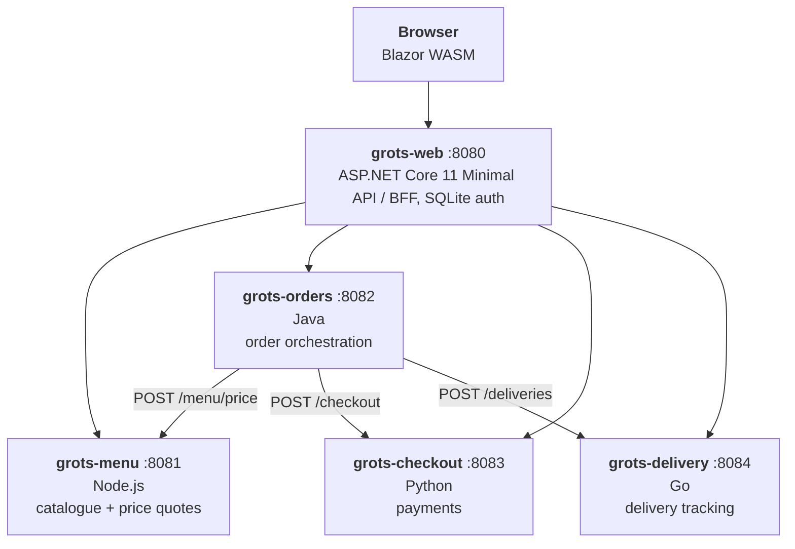

# Service contract

This document is the contract between the services that make up Grot's Pizzeria.
All services speak JSON over HTTP. JSON property names are `camelCase`.



## Conventions

| Concern | Convention |
| --- | --- |
| Listen port | `PORT` environment variable, defaulting to the port in the diagram above. Listen on all interfaces (`0.0.0.0`). |
| Downstream URLs | `MENU_URL`, `ORDERS_URL`, `CHECKOUT_URL`, `DELIVERY_URL` (no trailing slash). Defaults are `http://localhost:<port>`. |
| Health | `GET /healthz` → `200 {"status":"ok"}` (anonymous). Health checks are neither traced nor counted in the HTTP metrics by any application. |
| API documentation | `GET /openapi.json` is the OpenAPI document, and `GET /` is a page that shows it (Swagger UI), both anonymous. The BFF's page is at `/swagger`, as its root is the UI. See the README. |
| Auth | `Authorization: Bearer <jwt>` on everything else, see below |
| Errors | Non-2xx responses carry `{"title": string, "status": int, "detail": string}` |
| Service names | `OTEL_SERVICE_NAME` = `grots-web`, `grots-menu`, `grots-orders`, `grots-checkout`, `grots-delivery` |
| OTLP | Only standard `OTEL_*` environment variables are used for configuration. The compose file sets `OTEL_EXPORTER_OTLP_ENDPOINT` and `OTEL_EXPORTER_OTLP_PROTOCOL=http/protobuf`. |
| Semconv | `OTEL_SEMCONV_STABILITY_OPT_IN=http` is set for runtimes that need it to emit the stable HTTP semantic conventions. |
| Money | JSON numbers rounded to 2 decimal places, in the currency that is given with them (`currency`, an ISO 4217 code such as `GBP`). The menu service decides it (`CURRENCY`, `GBP` by default) and nothing else assumes one. |
| Timestamps | ISO-8601 UTC (`2026-11-01T10:00:00Z`). |

## Service-to-service security (JWT)

Every call between applications carries a JWT bearer token (`Authorization: Bearer <jwt>`). Only `GET /healthz` and the
API documentation (`GET /` and `GET /openapi.json`) are anonymous; every other endpoint of menu, orders, checkout and delivery returns `401` (problem body, `title: "Unauthorized"`)
when the token is missing, malformed, expired, or fails validation.

* The BFF (`grots-web`) mints the tokens. For a signed-in user `sub` is the user id; for anonymous browsing it is `anonymous`.
* `grots-orders` forwards the token it received to menu, checkout and delivery (token propagation, so the caller's
  identity flows through the whole trace).
* Signing: **HS256** with a shared secret. Validation checks signature, `exp` (30s clock skew at most), `iss` and `aud`.
* Claims: `iss` = `grots-web`, `aud` = `grots-pizzeria`, `sub`, `name` (username, when signed in), `iat`, `exp` (5 minutes).
* Configuration (environment variables; every service reads the same three):

| Variable | Default | Notes |
| --- | --- | --- |
| `JWT_SIGNING_KEY` | _(none, required)_ | At least 32 bytes (256 bits) of text. The service refuses to start without it. |
| `JWT_ISSUER` | `grots-web` | |
| `JWT_AUDIENCE` | `grots-pizzeria` | |

A real deployment would use asymmetric keys and a JWKS endpoint; HS256 keeps the sample to one environment variable.
Use each language's established JWT library.

## Trace context and baggage

Every application propagates the W3C trace context (`traceparent`, and `tracestate`) and baggage (`baggage`), and nothing else:
`OTEL_PROPAGATORS=tracecontext,baggage` (the Go service sets the same in code). `traceparent` carries the sampling decision, so
a trace that was not sampled where it started is not sampled anywhere in it (the SDKs' default `parentbased_always_on`
sampler honours the parent); `tracestate` is passed through untouched.

The browser sets baggage `grot.ui.action` (for example `place-order`) when the user acts. Each service copies baggage whose key
starts with `grot.` onto its spans as an attribute, so the user's action can be seen on every span of the trace.

## Custom telemetry (the `grot.*` namespace)

Each service emits one or two custom business signals in addition to the HTTP instrumentation. They are described
in the Weaver registry in [`weaver/registry`](../weaver/registry) so that live-check treats them as known.

| Signal | Type | Unit | Attributes | Emitted by |
| --- | --- | --- | --- | --- |
| `grot.menu.price_quotes` | counter | `{quote}` | _(none)_ | grots-menu |
| `grot.orders.placed` | counter | `{order}` | `grot.order.outcome` = `placed`/`rejected`/`failed` | grots-orders |
| `grot.checkout.payments` | counter | `{payment}` | `grot.payment.method` = `card`/`cash`, `grot.payment.outcome` = `approved`/`declined`/`error` | grots-checkout |
| `grot.deliveries.active` | updowncounter | `{delivery}` | _(none)_ | grots-delivery |
| `grot.auth.attempts` | counter | `{attempt}` | `grot.auth.operation` = `login`/`register`, `grot.auth.outcome` = `success`/`failure` | grots-web |

Server spans of the order endpoints also carry a `grot.order.id` string attribute where the order id is known.

## grots-menu (Node.js, `:8081`)

### `GET /menu` → `200`

```json
[
  {
    "id": "margherita", "name": "Margherita", "description": "...", "category": "pizza", "price": 9.5, "currency": "GBP", "vegetarian": true, "popular": false, "emoji": "🍕",
    "offer": { "discount": 0.15, "price": 8.08, "endsAt": "2026-11-01T10:05:00.000Z" }
  }
]
```

`price` is always the list price, in the `currency` that the item says (as is the offer's price). `offer` is `null` unless the item is on **special offer**: every 5 minutes of wall-clock time
(10:00:00 to 10:04:59.999, 10:05:00 to 10:09:59.999, ...) one item from each section (one pizza, one side and one dessert) is chosen at random
and goes on offer. `offer.discount` is the fraction taken off (`0.15`, 15% off, unless the service has `OFFER_DISCOUNT` set to something else), so clients
show whatever it is rather than assuming a rate. `offer.price` is the list price less `discount`, to the nearest penny, and `endsAt` is when the period ends.
The same item may be chosen in consecutive periods. The choice is a pure function of the period, so every instance agrees.
`SPECIAL_OFFERS=off` switches the offers off (every `offer` is `null`).

Pizzas (ids), cheapest to dearest, with the house special (named after the mascot) the dearest: `marinara` 8.50, `margherita` 9.50, `pepperoni` 11.00, `hawaiian` 11.50, `veggie-supreme` 12.00, `diavola` 12.25, `bbq-chicken` 12.50, `quattro-formaggi` 12.50, `prosciutto-e-rucola` 13.00, `funghi-tartufo` 13.50, `meat-feast` 13.75, `grot-special` 14.00.
Sides (`"category": "side"`), cheapest to dearest: `coleslaw` 3.00, `marinated-olives` 3.50, `potato-wedges` 4.00, `side-salad` 4.00, `onion-rings` 4.25, `garlic-bread` 4.50, `sweet-potato-fries` 4.50, `dough-balls` 4.75, `garlic-cheese-flatbread` 5.25, `caesar-salad` 5.50, `mozzarella-sticks` 5.75, `chicken-wings` 6.50.
`popular` marks the items shown with a "Popular" badge: `grot-special`, `veggie-supreme`, `pepperoni`, `quattro-formaggi`,
`garlic-bread`, `side-salad`, `marinated-olives`, `sweet-potato-fries`, `chicken-wings`, `vanilla-gelato` and `tiramisu`.

Desserts (`"category": "dessert"`), cheapest to dearest, all vegetarian: `lemon-sorbet` 3.75, `vanilla-gelato` 4.00, `chocolate-brownie` 4.75, `affogato` 5.00, `strawberry-cheesecake` 5.50, `tiramisu` 5.75.

Order lines use `pizzaId` for the id of any menu item, pizza, side or dessert.

### `GET /menu/{id}` → `200` one item, `404` if unknown

### `POST /menu/price` → `200`

Request: `{ "items": [ { "pizzaId": "margherita", "quantity": 2 } ] }`

Prices are what the items cost now, so an item on special offer is priced at its offer price. Response:

```json
{
  "lines": [ { "pizzaId": "margherita", "name": "Margherita", "quantity": 2, "unitPrice": 9.5, "lineTotal": 19.0 } ],
  "subtotal": 19.0,
  "currency": "GBP"
}
```

`400` if `items` is empty, a quantity is not an integer between 1 and 20, or a pizza id is unknown.

## grots-checkout (Python, `:8083`)

### `POST /checkout` → `201`

Request:

```json
{ "orderId": "ord_123", "amount": 19.0, "currency": "GBP", "paymentMethod": "card", "cardLast4": "4242" }
```

Response:

```json
{ "transactionId": "txn_...", "orderId": "ord_123", "subtotal": 19.0, "tax": 1.52, "taxRate": 0.08, "total": 20.52,
  "currency": "GBP", "status": "approved" }
```

* `currency` is required: a 3 letter ISO 4217 code in capitals, which is the currency of `amount` (the one the menu prices things in). The receipt repeats it.
* Tax is `TAX_RATE` (default `0.08`, 8%) of the amount, rounded to 2 decimal places. `total = amount + tax`. `taxRate` is the rate that
  was applied, as a fraction (`0.08` is 8%). It is the only place a client learns it, so clients show it from the receipt rather than assuming one.
* `paymentMethod` is `card` or `cash`. `cardLast4` is required for `card` (4 digits).
* `402` (`title: "Payment declined"`) when `cardLast4` is `0000`.
* `503` (`title: "Payment gateway unavailable"`) when `cardLast4` is `0503`, so that a failure can be had on demand, and for a
  random fraction of the others (`CHECKOUT_FAILURE_RATE`).
* `503` (`title: "Payment gateway unavailable"`) randomly for a fraction of requests, configured by
  `CHECKOUT_FAILURE_RATE` (default `0.05`, `0` disables it). This is deliberate: it makes the telemetry interesting.
* Each request takes a simulated 50–250ms to "talk to the payment gateway".
* `400` for invalid input.

## grots-delivery (Go, `:8084`)

Deliveries are held in memory. Progress is derived from elapsed time so the UI can poll tracking: with the default
`DELIVERY_STEP_SECONDS=15`, a delivery moves `preparing` → `baking` → `quality-control` → `out-for-delivery` → `delivered`, one step every
15 seconds.

### `POST /deliveries` → `201`

Request: `{ "orderId": "ord_123", "address": "1 Loki Lane", "itemCount": 3 }`

Response: a tracking document (see below). `400` for invalid input. Idempotent per `orderId` (a repeat returns `200`
with the existing delivery).

### `GET /deliveries/{orderId}` → `200`

```json
{
  "orderId": "ord_123",
  "address": "1 Loki Lane",
  "status": "baking",
  "driver": "Tempo Tim",
  "etaMinutes": 27,
  "createdAt": "2026-11-01T10:00:00Z",
  "updatedAt": "2026-11-01T10:00:20Z",
  "steps": [
    { "status": "preparing",        "label": "Preparing your order",   "completed": true,  "reached": true,  "at": "2026-11-01T10:00:00Z" },
    { "status": "baking",           "label": "Baking in the oven",     "completed": false, "reached": true,  "at": "2026-11-01T10:00:15Z" },
    { "status": "quality-control",  "label": "Quality control",        "completed": false, "reached": false, "at": "2026-11-01T10:00:30Z" },
    { "status": "out-for-delivery", "label": "Out for delivery",       "completed": false, "reached": false, "at": "2026-11-01T10:00:45Z" },
    { "status": "delivered",        "label": "Delivered",              "completed": false, "reached": false, "at": "2026-11-01T10:01:00Z" }
  ]
}
```

`reached` is true for the current step and every step before it. `at` is when the delivery reached the step, or for
steps not yet reached, when it is expected to.

`404` if unknown.

## grots-orders (Java, `:8082`)

Orders are held in memory. Placing an order calls menu (price), checkout (charge) and delivery (schedule), in that
order, and fails fast if any step fails.

### `POST /orders` → `201`

Request:

```json
{
  "userId": "42", "userName": "Grot",
  "address": "1 Loki Lane",
  "items": [ { "pizzaId": "margherita", "quantity": 2 } ],
  "payment": { "method": "card", "cardLast4": "4242" }
}
```

Response (an order):

```json
{
  "id": "ord_...", "userId": "42", "userName": "Grot", "status": "confirmed",
  "address": "1 Loki Lane",
  "items": [ { "pizzaId": "margherita", "name": "Margherita", "quantity": 2, "unitPrice": 9.5, "lineTotal": 19.0 } ],
  "subtotal": 19.0, "tax": 1.52, "taxRate": 0.08, "total": 20.52, "currency": "GBP",
  "transactionId": "txn_...", "createdAt": "2026-11-01T10:00:00Z"
}
```

Errors: `400` invalid request (or unknown pizza, propagated from menu), `402` payment declined (propagated from checkout),
`502` any other downstream failure (e.g. checkout returned `503`).

### `GET /orders?userId={id}` → `200` array of orders, newest first

### `GET /orders/{id}` → `200` an order, `404` if unknown

## grots-web (ASP.NET Core 11, `:8080`) – the BFF

Serves the Blazor WebAssembly app and the `/api` surface below. Authentication is a cookie issued by the app itself using
ASP.NET Core Identity (EF Core + SQLite). A demo user `grot` / `Grot!Pizza1` is seeded on first run.

| Method & path | Auth | Delegates to |
| --- | --- | --- |
| `POST /api/auth/register` | no | SQLite |
| `POST /api/auth/login` | no | SQLite |
| `POST /api/auth/logout` | yes | — |
| `GET  /api/auth/me` | no | — (`{ "isAuthenticated": bool, "username"?, "displayName"? }`) |
| `GET  /api/config` | no | — (`{ "telemetryUrl": string, "otlpEndpoint"?: string }`: where the UI's "See telemetry" link goes, and where the browser sends its OTLP) |
| `GET  /api/menu` | no | menu `GET /menu` |
| `POST /api/orders` | yes | orders `POST /orders` (adds `userId`/`userName`) |
| `GET  /api/orders` | yes | orders `GET /orders?userId=` |
| `GET  /api/orders/{id}` | yes | orders `GET /orders/{id}` (must be owned by the caller) |
| `GET  /api/orders/{id}/tracking` | yes | delivery `GET /deliveries/{orderId}` |
